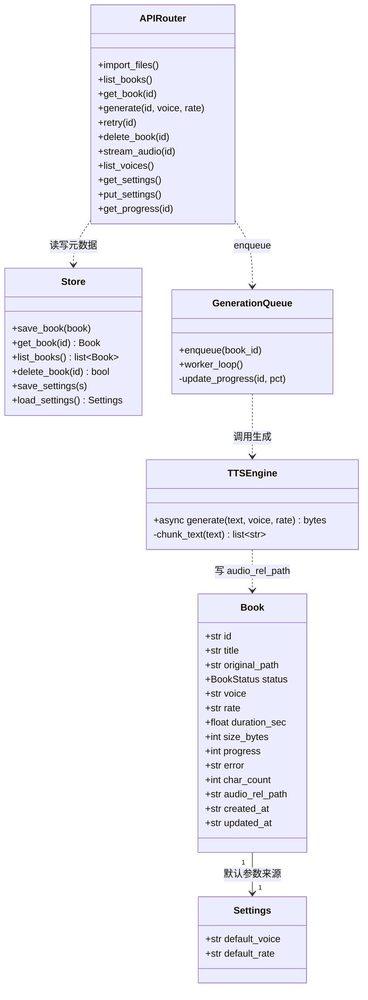
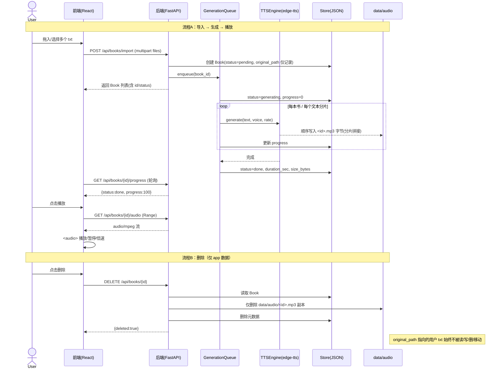

# 听书宝（listen_book）· 系统架构设计 + 任务分解

> 版本：v1.0 ｜ 架构师：高见远（Bob）｜ 语言：简体中文
> 形态：本地网页应用（前后端均运行于本机）
> 技术栈：后端 Python 3.11 + FastAPI + edge-tts；前端 Vite + React + MUI + Tailwind CSS

---

## 1. 实现方案与框架选型

### 1.1 后端服务职责

后端为单进程 FastAPI 应用，承担全部"重活"与本地文件管理：

- **导入与元数据**：接收前端上传的 txt（仅读取，绝不写/删/移动原始文件），登记 `Book` 元数据。
- **TTS 生成**：封装 `edge-tts`，按 voice/rate 将文本转为 mp3，长文本自动分片顺序生成并拼接落盘到 `data/audio/<id>.mp3`。
- **生成队列**：后台单 worker 顺序（有限并发）消费导入任务，驱动 `status` 在 `pending→generating→done/failed` 间流转并上报 `progress`。
- **静态托管**：运行态同时托管前端构建产物（`frontend/dist`），单命令即可在浏览器使用整站。

### 1.2 前后端通信

- **REST + JSON** 作为主通道：所有业务操作走 `/api/...`。
- **音频流**：`GET /api/books/{id}/audio` 返回 `audio/mpeg`，支持 HTTP `Range` 以便播放器拖动/seek。
- **进度**：以**轮询** `GET /api/books/{id}/progress` 为主（实现简单、兼容好）；SSE（`/api/books/{id}/events`）作为可选增强，不在 P0 强制。
- 统一响应包：`{ code, data, message }`（`code=0` 成功）。

### 1.3 开发与运行模式

| 模式 | 启动方式 | 说明 |
| --- | --- | --- |
| 开发态 | 后端 `uvicorn backend.main:app --reload --port 8000`；前端 `cd frontend && npm run dev`（:5173） | Vite dev server 通过 `proxy` 将 `/api` 转发到 `:8000` |
| 运行态 | 后端 `python run.py`（或 `uvicorn backend.main:app`） | 先 `npm run build` 产出 `frontend/dist`，后端挂载为静态站点根路径，浏览器访问 `http://localhost:8000` 即完整可用 |

### 1.4 目录结构

```
/workspace/listen-book/
├── backend/                 # 后端（Python，需 venv）
│   ├── requirements.txt
│   ├── run.py               # 运行态入口（启动 uvicorn + 挂载静态）
│   ├── main.py              # FastAPI app、CORS、路由注册、静态挂载
│   ├── config.py            # 路径常量、端口、VOICES 音色目录
│   ├── models.py            # Book / Settings 数据模型（pydantic）
│   ├── store.py             # JSON 持久化（books.json / settings.json）
│   ├── tts.py               # edge-tts 封装（voice/rate、分片、拼接）
│   └── queue.py             # 后台生成队列 / worker
├── frontend/                # 前端（Vite + React + MUI + Tailwind）
│   ├── package.json
│   ├── vite.config.js       # dev proxy / build 配置
│   ├── tailwind.config.js
│   ├── postcss.config.js
│   ├── index.html
│   └── src/
│       ├── main.jsx
│       ├── App.jsx          # AppShell + 全局状态/Context + Snackbar 通知
│       ├── index.css        # Tailwind 指令
│       ├── api/client.js    # API 客户端（baseURL、错误处理）
│       └── components/
│           ├── ImportZone.jsx
│           ├── Bookshelf.jsx
│           ├── BookCard.jsx
│           ├── PlayerDrawer.jsx   # 播放/暂停/进度/倍速（含 audio 控制逻辑）
│           └── SettingsPanel.jsx
├── data/                    # app 数据目录（gitignore；运行期生成）
│   ├── audio/<book_id>.mp3
│   ├── books.json
│   └── settings.json
└── docs/
    ├── PRD.md
    ├── ARCHITECTURE.md
    ├── class-diagram.mermaid
    └── sequence-diagram.mermaid
```

---

## 2. 文件列表（相对路径）

后端（8 个）：

| 文件 | 职责 |
| --- | --- |
| `backend/requirements.txt` | 后端依赖声明（fastapi / uvicorn / edge-tts / python-multipart） |
| `backend/run.py` | 运行态入口：启动 uvicorn 并挂载 `frontend/dist` 静态资源 |
| `backend/main.py` | FastAPI 实例、CORS、全部 `/api` 路由注册、静态挂载、健康检查 |
| `backend/config.py` | 路径常量（`DATA_DIR`/`AUDIO_DIR`）、端口、默认参数、中文音色目录 `VOICES` |
| `backend/models.py` | `Book`、`Settings` 等 pydantic 模型与枚举（`BookStatus`） |
| `backend/store.py` | JSON 持久化：books.json / settings.json 的原子读写 |
| `backend/tts.py` | edge-tts 封装：按 voice/rate 生成、长文分片、顺序写入拼接 mp3 |
| `backend/queue.py` | 后台生成队列与 worker：驱动状态流转、进度上报、失败标记 |

前端（14 个）：

| 文件 | 职责 |
| --- | --- |
| `frontend/package.json` | 前端依赖与脚本（dev/build/preview） |
| `frontend/vite.config.js` | Vite 配置：React 插件、dev proxy `/api → :8000`、build 输出 |
| `frontend/tailwind.config.js` | Tailwind 内容扫描与主题 |
| `frontend/postcss.config.js` | PostCSS + Tailwind/Autoprefixer |
| `frontend/index.html` | SPA 入口 HTML |
| `frontend/src/main.jsx` | React 挂载入口 |
| `frontend/src/App.jsx` | AppShell 布局、全局 Context（书籍/播放/设置）、Snackbar 通知 |
| `frontend/src/index.css` | Tailwind 三条指令 + 基础样式 |
| `frontend/src/api/client.js` | 封装 baseURL、`{code,data,message}` 解析与统一错误处理 |
| `frontend/src/components/ImportZone.jsx` | 选择/拖拽多 txt 导入区 |
| `frontend/src/components/Bookshelf.jsx` | 书架列表容器，轮询刷新进度 |
| `frontend/src/components/BookCard.jsx` | 单本书卡片：状态/进度条/播放·删除·重试 |
| `frontend/src/components/PlayerDrawer.jsx` | 底部常驻播放器：播放/暂停/进度拖动/倍速（含 audio 控制） |
| `frontend/src/components/SettingsPanel.jsx` | 设置抽屉：默认音色与默认语速 |

---

## 3. 数据结构与接口

### 3.1 Book 元数据模型

| 字段 | 类型 | 说明 |
| --- | --- | --- |
| `id` | str(uuid) | 书籍唯一标识 |
| `title` | str | 书名（取 txt 文件名，去扩展名） |
| `original_path` | str | **仅记录用户原始 txt 绝对路径，绝不读改写删** |
| `status` | enum | `pending` / `generating` / `done` / `failed` |
| `voice` | str | 音色，如 `zh-CN-XiaoxiaoNeural` |
| `rate` | str | 生成语速字符串，如 `"+0%"` / `"+20%"` / `"-30%"` |
| `duration_sec` | float\|null | 音频时长（秒） |
| `size_bytes` | int\|null | 音频文件大小 |
| `progress` | int | 生成进度百分比 0–100 |
| `error` | str\|null | 失败原因 |
| `char_count` | int\|null | 文本字数 |
| `audio_rel_path` | str | app 内音频相对路径，如 `audio/<id>.mp3` |
| `created_at` | str(ISO8601 UTC) | 创建时间 |
| `updated_at` | str(ISO8601 UTC) | 最近更新时间 |

### 3.2 Settings 模型

| 字段 | 类型 | 说明 |
| --- | --- | --- |
| `default_voice` | str | 默认音色（新导入书籍套用） |
| `default_rate` | str | 默认生成语速，如 `"+0%"` |

### 3.3 REST API 表

| 方法 | 路径 | 请求体 | 响应 `data` | 说明 |
| --- | --- | --- | --- | --- |
| GET | `/api/health` | — | `{ok:true}` | 健康检查 |
| POST | `/api/books/import` | `multipart/form-data`: `files`(txt，支持多文件) | `books: Book[]` | 导入多个 txt（仅读取），登记并自动入队 |
| GET | `/api/books` | — | `books: Book[]` | 书架列表 |
| GET | `/api/books/{id}` | — | `Book` | 单本详情/状态 |
| GET | `/api/books/{id}/progress` | — | `{status, progress, error}` | 生成进度查询（轮询） |
| POST | `/api/books/{id}/generate` | `{voice?, rate?}` | `{id, status}` | 触发生成（可覆盖音色/语速） |
| POST | `/api/books/{id}/retry` | — | `{id, status}` | 失败重试 |
| DELETE | `/api/books/{id}` | — | `{deleted:true}` | **仅删除 app 数据（副本+元数据），不动原始文件** |
| GET | `/api/books/{id}/audio` | — (支持 `Range`) | `audio/mpeg` 流 | 获取音频流供播放器 |
| GET | `/api/voices` | — | `voices: [{id,name,gender,locale}]` | 可选音色列表 |
| GET | `/api/settings` | — | `Settings` | 读取设置 |
| PUT | `/api/settings` | `{default_voice, default_rate}` | `Settings` | 保存设置 |

> 说明：`SPD-001`（生成阶段语速）经 `generate`/`import` 的 `rate` 写入 mp3；`PLY-002`（播放倍速）由前端 `<audio playbackRate>` 实现，不影响文件。两者均覆盖。

### 3.4 类图



---

## 4. 程序调用流程（时序）



---

## 5. 有序任务列表

按实现顺序排列，覆盖后端脚手架 → 存储 → TTS → API → 队列 → 前端脚手架 → 客户端 → 导入 → 书架 → 播放器 → 设置 → 托管/联调。

| 编号 | 任务 | 依赖 | 对应文件 | 验收点 |
| --- | --- | --- | --- | --- |
| T1 | 后端脚手架与依赖（venv/requirements/main/config，健康检查） | 无 | `backend/requirements.txt`, `backend/main.py`, `backend/config.py` | `python3 -m venv .venv` + `pip install -r requirements.txt` 成功；启动后 `GET /api/health` 返回 200 |
| T2 | 存储与元数据模块（Book/Settings 模型 + JSON 持久化） | T1 | `backend/models.py`, `backend/store.py` | 可创建 Book、原子读写 `books.json`/`settings.json`；字段齐全（含 `original_path` 仅记录） |
| T3 | edge-tts 封装与长文分片（voice/rate、~2000 字分片、顺序拼接落盘） | T1 | `backend/tts.py`, `backend/config.py`(VOICES) | 输入文本+voice+rate 产出合法 mp3 落 `data/audio/<id>.mp3`；>2000 字自动分片；仅联网时成功 |
| T4 | REST API 路由（import/list/detail/progress/generate/retry/delete/audio/voices/settings） | T2, T3 | `backend/main.py` | 全部端点手动/单测通过；`delete` 仅清 app 数据，不触碰 `original_path` |
| T5 | 生成队列与后台 worker（入队、状态流转、进度上报、失败标记） | T3, T4 | `backend/queue.py` | 多文件导入后顺序/有限并发生成；`pending→generating→done/failed`；`progress` 可轮询 |
| T6 | 前端脚手架（Vite+React+MUI+Tailwind，dev proxy） | 无 | `frontend/package.json`, `vite.config.js`, `tailwind.config.js`, `postcss.config.js`, `index.html`, `src/main.jsx`, `src/App.jsx`, `src/index.css` | `npm install` + `npm run dev` 打开空白页；`/api` 代理到 `:8000` |
| T7 | API 客户端（baseURL、`{code,data,message}` 解析、统一错误） | T6 | `frontend/src/api/client.js` | 各端点方法可用；错误以 Snackbar 提示 |
| T8 | 导入组件（点击/拖拽多选 txt，调用 import） | T6, T7 | `frontend/src/components/ImportZone.jsx`, `src/App.jsx` | 多选/拖拽导入成功；显示已加入数量；原始文件未被改动 |
| T9 | 书架与卡片（列表、状态、进度轮询、播放/删除/重试） | T7, T8 | `frontend/src/components/Bookshelf.jsx`, `BookCard.jsx` | 卡片展示书名/状态/进度条；完成态可播放；失败态可重试；定时轮询刷新 |
| T10 | 播放器（含倍速，底部常驻，audio 控制） | T9 | `frontend/src/components/PlayerDrawer.jsx` | 调用 `/audio` 流播放；播放/暂停/进度拖动；倍速 0.5/1/1.25/1.5/2x 即时生效 |
| T11 | 设置面板（默认音色/语速持久化，新导入套用） | T7 | `frontend/src/components/SettingsPanel.jsx` | 读取/保存默认音色与语速；音色取自 `/api/voices`；新导入套用 |
| T12 | 后端托管前端静态 + 联调与边界校验（单命令启动、删除红线校验） | T4, T5, T6–T11 | `backend/run.py`, `backend/main.py`(静态挂载), `frontend/`(build) | 单命令启动后浏览器访问根路径得完整可用 app；导入→生成→播放→删除全流程通过；删除后原始 txt 原样存在 |

---

## 6. 依赖包列表

**后端 `backend/requirements.txt`：**

```
fastapi>=0.110,<0.112
uvicorn[standard]>=0.29,<0.31
edge-tts>=6.1,<7.0
python-multipart>=0.0.9
```

**前端 `frontend/package.json` 关键依赖：**

```json
{
  "dependencies": {
    "react": "^18.3.1",
    "react-dom": "^18.3.1",
    "@mui/material": "^5.16.7",
    "@mui/icons-material": "^5.16.7",
    "@emotion/react": "^11.13.0",
    "@emotion/styled": "^11.13.0"
  },
  "devDependencies": {
    "vite": "^5.4.2",
    "@vitejs/plugin-react": "^4.3.1",
    "tailwindcss": "^3.4.10",
    "postcss": "^8.4.41",
    "autoprefixer": "^10.4.20"
  }
}
```

---

## 7. 共享知识（跨文件约定）

- **API base URL**：前端 `client.js` 取 `import.meta.env.VITE_API_BASE || '/api'`；开发态 Vite proxy 将 `/api` 转 `http://localhost:8000`，运行态同源，无需环境切换。
- **音频命名/存放**：固定 `data/audio/<book_id>.mp3`（`book_id`=uuid），`Book.audio_rel_path = "audio/<id>.mp3"`；经 `/api/books/{id}/audio` 流式返回。
- **元数据存放（明确选择 JSON 文件）**：`data/books.json`（Book 数组）与 `data/settings.json`（Settings 对象）。理由：单用户本地应用、零原生依赖、人易读易调试；SQLite 在本场景属过度设计。并发安全由**单一生成 worker 线程 + 同步原子写（temp 写后 rename）**保证。
- **状态码/错误格式**：统一 `{ code:int, data:any|null, message:string }`；`code=0` 成功，非 0 业务错误；HTTP 状态与 `code` 对齐（4xx/5xx）。
- **长文本分片策略**：按段落/句末标点将文本切分为 **≈2000 字符** 的分片（优先在换行/句号处断开，避免截断半句）；逐片调用 `edge-tts` 顺序 `stream()`，将 MPEG 字节**顺序追加**写入同一 `<id>.mp3`（同码率 48kbps/mono 可直接拼接播放，边界可能有极轻微爆音，v1 可接受；后续可选 ffmpeg 精确拼接）。
- **原始文件红线（强制）**：`original_path` 仅作记录，后端任何路径（import/delete/retry）**只读取用户 txt 内容，绝不写/删/移动**；`delete` 仅删除 `data/audio/<id>.mp3` 与 `books.json` 中对应元数据。

---

## 8. 待明确事项

1. **批量并发生成上限**：顺序生成还是有限并发（建议默认并发 1–2，避免 edge-tts 限流），需定调。
2. **分章（CHP-001）**：v1 是否纳入章节级跳转？当前架构以单文件单 mp3 设计，分章需扩展元数据与播放器。
3. **语速生效阶段标注**：已双覆盖（生成阶段 rate + 播放阶段倍速），但 UI 文案需明确区分，避免用户混淆。
4. **网络异常处理细节**：离线/弱网下 import 后生成失败的提示文案与自动重试退避策略待定。
5. **元数据扩展**：是否需要作者/封面/字数展示等字段（当前已留 `char_count`，其余可后续加）。
6. **音频缓存清理（CAC-001）**：`data/audio` 占用展示与一键清理入口是否纳入 v1。
