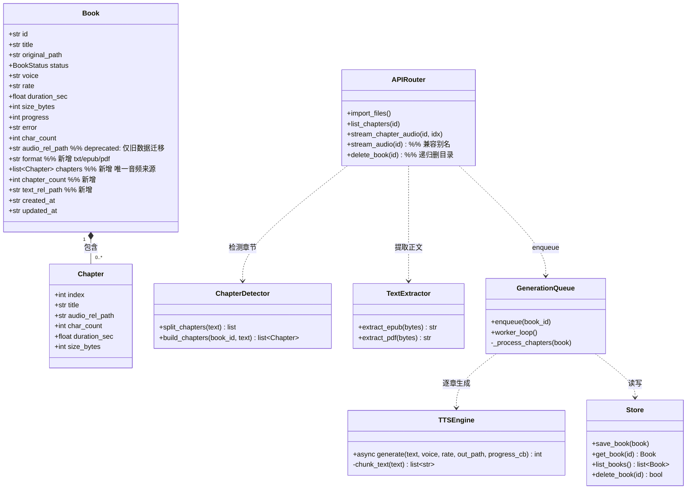
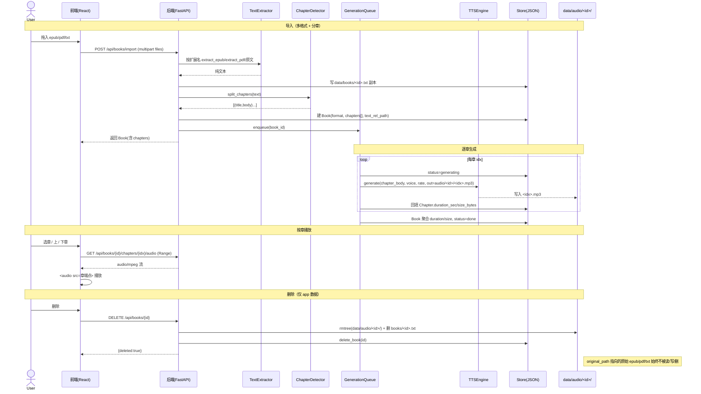

# 听书宝（listen_book）· 增量设计与任务分解（v1.1）

> 版本：v1.1 增量 ｜ 架构师：高见远（Bob）｜ 语言：简体中文
> 形态：本地网页应用（前后端均运行于本机）
> 技术栈：后端 Python 3.11 + FastAPI + edge-tts；前端 Vite + React + MUI + Tailwind CSS
> 关联文档：`ARCHITECTURE.md`（v1.0 基线）、`PRD_INCREMENT.md`

---

## 0. 与既有架构的关系（红线与不变项）

本次增量**不推翻** v1.0 基线，仅在之上叠加三项 P0 增强。明确继承项：

| 项目 | 基线约定 | 本次是否改变 |
| --- | --- | --- |
| 原始文件红线 | `original_path` 仅记录，后端绝不读/写/删/移动用户 txt/epub/pdf | **不变**（强化） |
| 运行态单命令 | `python backend/run.py` 托管 `frontend/dist` | **不变**（脚本封装它） |
| edge-tts 版本 | `requirements.txt` 已写 `edge-tts>=7.0` | **不变**（用户已验证） |
| Python venv | 系统 Python 需 venv | **不变**（脚本负责建） |
| JSON 持久化 | `books.json` / `settings.json` 原子写 | **不变**（字段增量扩展） |
| 音频流 Range | `audio/mpeg` + HTTP `Range` 拖动 | **不变**（下放到按章） |
| 统一响应 | `{code,data,message}`，`code==0` 成功 | **不变** |
| 文本副本目录 | `data/books/<id>.txt`（`config.BOOKS_DIR`） | **不变**（沿用，避免重命名/迁移） |

> **命名对齐说明**：PRD 把文本副本写作 `data/text/<book_id>.txt`，而基线 `config.BOOKS_DIR` 实为 `data/books/`。为**最小改动、避免 migration**，本设计**沿用既有 `data/books/<id>.txt`**，音频目录是本次唯一新增层级的目录。所有文档以 `BOOKS_DIR` 为准。

---

## 1. 存储结构变更

### 1.1 新存储布局

```
data/
├── audio/<book_id>/<idx>.mp3     # 新增：每章一个 mp3，idx 从 0 起
├── books/<book_id>.txt           # 沿用：提取后的纯文本副本（txt/epub/pdf 共用）
├── books.json                    # 沿用：Book 数组（含 chapters）
└── settings.json                 # 沿用
```

音频由「单文件」升级为「按书籍分目录、按章分文件」。**唯一变更点即音频目录层级**，文本副本、元数据均不变。

### 1.2 章节索引从 0 起（明确选择）

- **采用 0-based 索引**：`idx ∈ [0, chapter_count-1]`。
- 理由：
  1. 与 Python `list`、JS `Array` 下标天然一致，前端 `chapters[cur]` 无 +1/-1 心智负担；
  2. 音频端点 `GET /api/books/{id}/chapters/{idx}/audio` 的 `{idx}` 即数组下标，零转换；
  3. 文件名 `<idx>.mp3` 排序即播放序，目录 `ls` 天然有序。

### 1.3 兼容性 / 迁移策略（最小改动核心）

**关键决策：让「无章节 = 单章」统一走章节结构，从而旧逻辑几乎不改。**

- 导入后无论是否检测到章节，`Book.chapters` **始终**是一个数组：
  - 检测到 N 章 → N 个 `Chapter`；
  - 未检测到 → 一个兜底 `Chapter`（index=0, title=书名或「全文」）。
- 由此 `/audio` 端点、播放器、删除逻辑全部以 `chapters` 为唯一音频来源，**彻底消除「单文件」与「分章」两套分支**。

**旧数据（v1.0 遗留的 `audio/<id>.mp3` + `audio_rel_path`）迁移：**

在 `store.load/list_books` 读取时做一次**惰性迁移**（不回写文件，仅内存补全）：
- 若 `Book` 有 `audio_rel_path`（旧字段）且 `chapters` 为空 → 合成一个 `Chapter(index=0, title=书名, audio_rel_path=旧值)`，并标记 `legacy_single=True`（仅供兼容，不再新写）。
- 同时删除旧 `audio/<id>.mp3` 的清理仍由 `DELETE` 路由负责（见 §4）。

### 1.4 `Book.audio_rel_path` 处置

- **结论**：该字段**保留但降级为 deprecated**，仅用于 v1.0 旧数据惰性迁移读取；**新书的唯一音频来源是 `Book.chapters`**。
- 新 `tts`/队列代码**不再写** `audio_rel_path`，只写各 `Chapter.audio_rel_path`。
- 旧 `GET /api/books/{id}/audio` 端点**保留为兼容别名**：返回 `chapters[0].audio_rel_path` 对应文件（存在则流，否则 404）。新前端一律走按章端点。

---

## 2. 数据模型增量

### 2.1 `Chapter` 模型（新增，`backend/models.py`）

| 字段 | 类型 | 说明 |
| --- | --- | --- |
| `index` | int | 章节序号，**从 0 起** |
| `title` | str | 章节标题（取自检测到的标题文本；兜底为书名/「全文」） |
| `audio_rel_path` | str | app 内相对路径，如 `audio/<book_id>/0.mp3` |
| `char_count` | int | 该章文本字数 |
| `duration_sec` | float\|null | 该章音频时长（秒） |
| `size_bytes` | int\|null | 该章 mp3 字节数 |

### 2.2 `Book` 增量字段（最小扩展，保留全部旧字段）

| 字段 | 类型 | 说明 |
| --- | --- | --- |
| `format` | str | 来源格式：`txt` / `epub` / `pdf`（新增） |
| `chapters` | list[Chapter] | **新增，唯一音频来源**（旧 `audio_rel_path` 仅作迁移读取） |
| `chapter_count` | int | `len(chapters)` 冗余快照，便于卡片直显（新增） |
| `text_rel_path` | str | 文本副本相对路径，如 `books/<id>.txt`（新增，沿用 `BOOKS_DIR`） |
| `audio_rel_path` | str | **保留、deprecated**：仅 v1.0 旧数据惰性迁移用，新书不写 |

> `Book` 其余字段（`id`/`title`/`original_path`/`status`/`voice`/`rate`/`duration_sec`/`size_bytes`/`progress`/`error`/`char_count`/`created_at`/`updated_at`）**完全保留不变**。其中 `Book.duration_sec`/`size_bytes` 在新模型中改为「全书聚合值」（各章求和），与卡片展示兼容。

### 2.3 最小改动 `models.py` / `store.py`

- **`models.py`**：新增 `class Chapter(BaseModel)`；`Book` 增加 `format`、`chapters`、`chapter_count`、`text_rel_path` 字段（带默认值，保证旧 JSON 反序列化不报错），`audio_rel_path` 保留但文档标注 deprecated。
- **`store.py`**：`get_book`/`list_books`/`Book(**raw)` 反序列化天然兼容新字段；**仅在 `list_books` 内对每条做 `_migrate_legacy_audio(book)`**：检测旧 `audio_rel_path` 且无 `chapters` 时补一个 `Chapter`。`save_book`/`delete_book` 无需改签名（删除的目录递归清理在 `main.py` 做）。
- **`config.py`**：新增 `AUDIO_SUBDIR` 概念无需新常量——直接用 `AUDIO_DIR / book_id / f"{idx}.mp3"`；无需新增目录常量（沿用 `AUDIO_DIR`、`BOOKS_DIR`）。

---

## 3. 章节检测策略

### 3.1 函数设计（新增 `backend/chapter.py`）

设计独立模块，输入全文 → 输出 `list[(title, text)]`，与 TTS/队列解耦，便于单测。

```python
# 设计伪签名（非实现）
def split_chapters(text: str) -> list[tuple[str, str]]:
    """返回 [(title, body_text), ...]，至少 1 章。"""

def build_chapters(book_id: str, text: str) -> list[Chapter]:
    """split_chapters 的封装：生成 Chapter（填 index/title/audio_rel_path 占位）。"""
```

复用既有 `tts.chunk_text` 仅用于「章内长文分片」，章节切分是更高一层，不冲突。

### 3.2 规则优先级（从高到低，命中即切）

| 优先级 | 规则 | 正则/判定 | 切分点 |
| --- | --- | --- | --- |
| P1 | 中文章回 | `^\s*第[0-9零一二三四五六七八九十百千]+[章回卷节部篇]\b` | 行首命中即新章 |
| P2 | 英文 Chapter | `^\s*chapter\s+\d+\b`(大小写不敏) | 行首命中即新章 |
| P3 | Markdown 标题 | `^\s{0,3}#{1,6}\s+.+` | `#` 标题行即新章 |
| P4 | 空行/大段分隔 | 连续 ≥2 空行，或在非标题大段（>阈值）前后 | 作为兜底软切分 |
| — | **兜底** | 以上均不匹配 | 整体作为单章（index=0） |

- **判定流程**：先按 P1–P3 扫描所有「候选章首行」，若候选数 ≥ 2 → 按候选切分；若候选 < 2 → 尝试 P4 大段分隔；若仍无 → 兜底单章。
- **标题提取**：章首匹配行的剩余文本作为 `title`；P4 无显式标题时，用 `第 N 章`（自增序号）或 `第 N 段` 兜底命名。
- **正文**：相邻章首之间的文本为该章 `body`（去首尾空白），空 body 章整体跳过（避免空章）。

### 3.3 兜底与防误判（对齐 PRD 风险 §5.3）

- 任何异常/无匹配 → 返回 `[(title=书名或"全文", text=全文)]`，行为与 v1.0 单文件 txt 完全一致（CHP-002）。
- 「第X章 完」「作者有话说」等误判：P1 仅匹配标准章回词，不把「完/后记」当新章首；后续 P2（CHP-011 合并过碎章）列入迭代，不在 P0 强制。

---

## 4. REST 端点变更 / 新增

### 4.1 端点表

| 方法 | 路径 | 变更 | 请求 | 响应 `data` | 说明 |
| --- | --- | --- | --- | --- | --- |
| POST | `/api/books/import` | **改** | `files`(multipart，支持 `.txt/.epub/.pdf`) | `books: Book[]` | 按扩展名识别格式；epub/pdf 经提取后写入 `text_rel_path` 文本副本；非法扩展名返回 4xx 且不入队 |
| GET | `/api/books/{id}/chapters` | **新** | — | `chapters: Chapter[]`（含 index/title/duration_sec） | 章节列表（标题+时长），供播放器选择器 |
| GET | `/api/books/{id}/chapters/{idx}/audio` | **新** | 支持 `Range` | `audio/mpeg` 流 | 按章音频流，逻辑复用既有 Range 处理 |
| GET | `/api/books/{id}/audio` | **兼容保留** | 支持 `Range` | `audio/mpeg` 流 | 返回 `chapters[0]` 文件；旧数据/旧前端兼容别名，新前端不依赖 |
| DELETE | `/api/books/{id}` | **改** | — | `{deleted:true}` | 递归删 `data/audio/<id>/` 目录 + `data/books/<id>.txt` + 元数据；旧 `audio/<id>.mp3` 亦尝试删；**绝不碰 `original_path`** |
| GET | `/api/books/{id}` 等 | 沿用 | — | `Book` | `chapters`/`chapter_count`/`format` 出现在序列化中 |

### 4.2 各文件改动点

- **`main.py`**
  - `import_books`：扩展名分支（`txt`→直接解码；`epub`→`extract_epub`；`pdf`→`extract_pdf`）；写 `book.format`、`book.text_rel_path`、`book.chapters`（先 `split_chapters` 出占位，生成后再回填 duration/size）。
  - 新增 `get_chapters`、`get_chapter_audio`（Range 逻辑抽成 `_stream_audio(path, request)` 复用）。
  - `delete_book_route`：改为 `shutil.rmtree(AUDIO_DIR/<id>, ignore_errors=True)` + 删 `BOOKS_DIR/<id>.txt` + 旧 `AUDIO_DIR/<id>.mp3` + `delete_book`。
- **`backend/extract.py`（新增）**：`extract_epub(bytes)->str`（zipfile 读 `.xhtml/.html`，BeautifulSoup 取正文文本，忽略 `` 二进制、脚注按出现位置内联或忽略）、`extract_pdf(bytes)->str`（pypdf `extract_text`；检测空/字数 < 阈值 → 抛 `UnsupportedPDFError` 标「扫描版不支持」）。
- **`tts.py`**：保持 `generate(text, voice, rate, out_path, progress_cb)` 签名不变（按章调用，每章一个 `out_path`）。
- **`queue.py`**：`_process` 改为「遍历 `book.chapters`，逐章 `tts.generate` 到 `audio/<id>/<idx>.mp3`，累计进度 = 已完成章/总章 + 当前章内分片进度」，收尾回填每章 `duration_sec`/`size_bytes` 并聚合 `Book` 总时长/大小；删除期间清理改为 `rmtree(AUDIO_DIR/<id>)`。

---

## 5. 前端增量（最小改动方案）

| 文件 | 改动 | 说明 |
| --- | --- | --- |
| `ImportZone.jsx` | `accept=".txt,.epub,.pdf"`；`handleFiles` 过滤扩展名集合；文案提示三种格式 | 复用 `api.importBooks(files)`，后端按扩展名处理 |
| `api/client.js` | 新增 `getChapters(id)`、`getChapterAudioUrl(id, idx)`；`getAudioUrl` 保留兼容 | 仅加方法，不改既有 |
| `PlayerDrawer.jsx` | 新增 `chapters` 状态与 `cur` 章索引；`<audio src>` 改为 `getChapterAudioUrl(id, cur)`；增加章节 `<Select>` + 上一章/下一章 `IconButton`；切换时重置播放态 | 复用既有 audio 控制逻辑；倍速不变 |
| `BookCard.jsx` | 完成态增加「共 N 章」展示；`playBook` 传入 `chapters`（由 `getBook` 已含） | 最小：仅加一行章节数 |

**最小改动要点**：播放器以「当前章 `cur`」为核心状态，章节切换只换 `src` 并 `audio.load()`；不引入路由/状态库；`App.jsx` 的 `playBook(book)` 直接透传 `book.chapters`，无需新 Context 字段。

---

## 6. 一键启动脚本设计

### 6.1 `start.sh`（Linux/Mac，bash）

| 步骤 | 关键命令 | 说明 |
| --- | --- | --- |
| 1. 定位根目录 | `ROOT="$(cd "$(dirname "$0")" && pwd)"` | 脚本所在即项目根 |
| 2. 复用/建 venv | `[ -d .venv ] \|\| python3 -m venv .venv`；`source .venv/bin/activate` | 二次运行跳过建 venv |
| 3. 装后端依赖 | `pip install -r backend/requirements.txt` | 含 pypdf/beautifulsoup4 |
| 4. 前端依赖+构建 | `cd frontend && (npm ci \|\| npm install) && npm run build` | 构建到 `frontend/dist` |
| 5. 启动后端 | `cd "$ROOT" && python backend/run.py &`；`SERVER_PID=$!` | 后台托管 dist |
| 6. 等待端口 | 轮询 `curl -s localhost:8000/api/health` 直到 200 | 避免浏览器先于服务 |
| 7. 打开浏览器 | `xdg-open http://localhost:8000 \|\| open http://localhost:8000`（捕获失败→仅 `echo` URL） | 无图形界面降级不中断 |
| 8. 善后 | `wait $SERVER_PID`；`trap` 终止时杀子进程 | 优雅退出 |

> 增强（P2 RUN-008）：步骤 4 检测 `frontend/dist` 存在且 `node_modules` 存在则跳过，除非传入 `--force`。

### 6.2 `start.bat`（Windows，cmd）

等价流程：`py -3 -m venv .venv` → `call .venv\Scripts\activate` → `pip install -r backend\requirements.txt` → `cd frontend && npm install && npm run build` → `start "" http://localhost:8000`（失败降级 `echo`）→ `python backend\run.py`。用 `where xdg-open`/`start` 探测浏览器，失败仅打印 URL。

---

## 7. 依赖变更

`backend/requirements.txt`（在既有基础上追加，保留 `edge-tts>=7.0`）：

```
fastapi>=0.110,<0.112
uvicorn[standard]>=0.29,<0.31
edge-tts>=7.0
python-multipart>=0.0.9
beautifulsoup4>=4.12        # 新增：epub xhtml 正文提取
pypdf>=4.0                  # 新增：pdf 文本层提取
```

> 前端 `package.json` 无需新增依赖（章节 UI 用既有 MUI 组件即可）。

---

## 8. 有序增量任务列表（T1–T9）

> 依赖箭头：T1（依赖）→ T2。验收点均可在干净环境复现。

| 编号 | 任务 | 依赖 | 对应文件 | 验收点 |
| --- | --- | --- | --- | --- |
| **T1** | 依赖更新：requirements.txt 增加 `beautifulsoup4`、`pypdf`，保留 `edge-tts>=7.0` | 无 | `backend/requirements.txt` | `pip install -r requirements.txt` 成功；`python -c "import bs4, pypdf"` 不报错 |
| **T2** | 章节检测模块：实现 `split_chapters`/`build_chapters`（P1–P4 规则 + 兜底单章） | 无 | `backend/chapter.py`、`backend/models.py`(Chapter) | 网文/Markdown 正确切章；无匹配返回单章；单测覆盖中文章回/Chapter/Markdown/空行/兜底 |
| **T3** | 文本提取模块：epub（zipfile+BeautifulSoup）、pdf（pypdf，扫描版抛错） | 无 | `backend/extract.py` | epub 提取可读正文且不含图片二进制；含文本层 pdf 提取成功；空文本层 pdf 抛「扫描版不支持」而非崩溃 |
| **T4** | 模型与存储扩展：Book 增 `format/chapters/chapter_count/text_rel_path`；`audio_rel_path` 标 deprecated；`store` 加旧数据惰性迁移 | T2 | `backend/models.py`、`backend/store.py`、`backend/config.py`（沿用常量） | 旧 `books.json`（含 `audio_rel_path`）载入后 `chapters` 自动补单章；新 Book 序列化含 `chapters`；旧字段不丢 |
| **T5** | tts 按章生成 + 队列改造：逐章生成 `audio/<id>/<idx>.mp3`，聚合进度/时长 | T2,T4 | `backend/tts.py`(签名不变)、`backend/queue.py`、`backend/chapter.py` | 多章各自产出可播放 mp3；`progress` 轮询反映章聚合进度；生成期删除清理 `rmtree` |
| **T6** | API 变更：import 多格式（extract 接入）、章节列表、按章音频（Range 复用）、删除递归、旧 `/audio` 兼容别名 | T3,T4,T5 | `backend/main.py`、`backend/extract.py` | 三格式均导入成功；`/chapters` 返回列表；`/chapters/{idx}/audio` 支持 Range；DELETE 递归清目录且原始文件字节不变 |
| **T7** | 前端导入多格式：ImportZone accept 三格式 + 文案 | 无 | `frontend/src/components/ImportZone.jsx` | 选择器可多选三种格式；非法格式被过滤不报错 |
| **T8** | 前端章节播放器：client 加 `getChapters`/`getChapterAudioUrl`；PlayerDrawer 章选择+上/下章+跳转；BookCard 显章节数 | T6,T7 | `frontend/src/api/client.js`、`PlayerDrawer.jsx`、`BookCard.jsx` | 播放器显示章节列表；上/下章/点击跳转切换 `<audio src>`；卡片显示「共 N 章」 |
| **T9** | 一键启动脚本：start.sh / start.bat（venv 复用、依赖、构建、启动、打开浏览器、无浏览器降级） | T6,T8 | `start.sh`、`start.bat`（项目根） | 干净环境 `bash start.sh` 后浏览器开 `http://localhost:8000` 得完整 app；二次运行复用 venv/构建；无界面仅打印 URL 不中断 |
| **T10** | 联调与回归（红线校验）：epub/pdf/分章全流程 + 删除仅清 app 数据断言 | T6,T8,T9 | `backend/main.py`、`docs/`（回归说明） | 导入→生成→分章播放→删除全流程通过；删除后 `original_path` 指向文件 size/mtime 不变；旧单文件书仍可播放 |

> 注：T7/T8 可在 T6 完成前并行开发（前端 mock 数据），但联调依赖 T6。T10 为收尾回归，覆盖红线在 epub/pdf/分章下仍成立。

---

## 9. 共享约定 / 风险

### 9.1 共享约定

- **音频目录约定**：`data/audio/<book_id>/<idx>.mp3`，`<idx>` 0-based，`Chapter.audio_rel_path = "audio/<book_id>/<idx>.mp3"`。
- **章节索引从 0 起**（见 §1.2）。
- **唯一音频来源**：`Book.chapters`；`audio_rel_path` 仅旧数据迁移用。
- **文本副本**：`data/books/<book_id>.txt`（沿用 `BOOKS_DIR`），三格式统一落此。
- **统一响应/Range**：沿用 `{code,data,message}`；按章音频复用既有 Range 逻辑。
- **进度聚合**：总进度 = `已完成章数/总章数` + 当前章内分片进度（P1 CHP-004 的 P0 简化版，先保证可轮询）。

### 9.2 风险与对策

| 风险 | 对策 |
| --- | --- |
| 扫描版 pdf 无文本层 | `extract_pdf` 检测提取字数 < 阈值 → 抛 `UnsupportedPDFError`，API 标记该书 `failed` + `error="扫描版 PDF 无文本层，暂不支持"`，**不崩溃**、不引入 OCR |
| epub 图片/脚注 | 仅取文本节点，`` 二进制不进文本；图注 `alt` 可选忽略；脚注按出现位置内联为普通段落（或忽略），不与正文争章节 |
| 分章误判（「第X章 完」等） | P1 仅匹配标准章回词；兜底单章（§3.3）；合并过碎章（CHP-011）留迭代 |
| 无浏览器环境 | 脚本捕获 `xdg-open/open/start` 失败 → 仅 `echo URL`，**不中断**已启动服务（§6、PRD §5.4） |
| 删除红线在分章下成立 | `DELETE` 仅 `rmtree(data/audio/<id>)` + 删 `data/books/<id>.txt` + 元数据；回归断言 `original_path` 文件 size/mtime 不变（T10） |
| 依赖体积/首装时长 | pypdf/beautifulsoup4 为纯 Python，增量小；`--force` 增量构建（RUN-008）缩短二次启动 |
| 旧数据兼容 | `store` 惰性迁移补单章；旧 `/audio` 端点作 `chapters[0]` 别名，零破坏性 |

---

## 附：类图（增量）



## 附：时序图（增量：epub 分章导入 → 生成 → 按章播放 → 删除）


