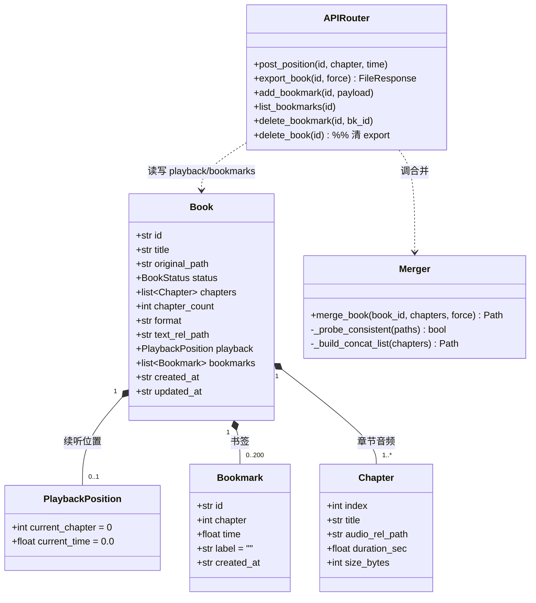
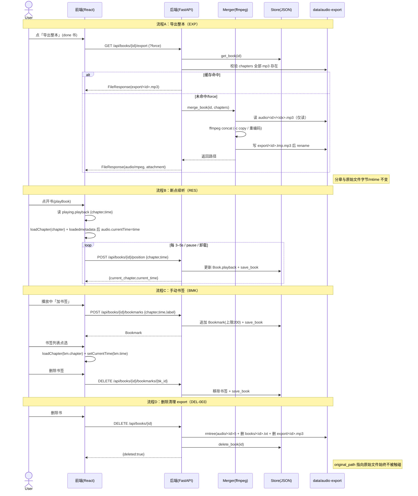

# 听书宝（listen_book）· 增量设计与任务分解（v1.2）

> 版本：v1.2 增量 ｜ 架构师：高见远（Bob）｜ 语言：简体中文
> 形态：本地网页应用（前后端均运行于本机）
> 技术栈：后端 Python 3.11 + FastAPI + edge-tts；前端 Vite + React + MUI + Tailwind CSS
> 关联文档：`ARCHITECTURE.md`（v1.0 基线）、`ARCHITECTURE_INCREMENT.md`（v1.1 分章）、`PRD_INCREMENT2.md`

---

## 0. 与既有架构的关系（红线与不变项）

本次增量**不推翻** v1.0/v1.1，仅在其上叠加「合并导出整本 mp3」「断点续听」「手动书签」三项能力。明确继承项：

| 项目 | 基线约定 | 本次是否改变 |
| --- | --- | --- |
| 原始文件红线 | `original_path` 仅记录（v1.1 起仅存 basename），后端绝不读/写/删/移动用户 txt/epub/pdf | **不变**（强化） |
| 分章音频结构 | `data/audio/<book_id>/<idx>.mp3`，idx 从 0 起，`Book.chapters` 为唯一音频来源 | **不变** |
| JSON 持久化 | `books.json` 原子写（temp 写后 rename）；并发由单生成 worker 保证 | **不变**（字段增量扩展） |
| 统一响应 | `{code,data,message}`，`code==0` 成功 | **不变** |
| 文本副本目录 | `data/books/<book_id>.txt`（`BOOKS_DIR`） | **不变** |
| ffmpeg 已可用 | 沙箱路径 `/usr/local/bin/ffmpeg`（版本 2026） | **不变**（本次首次使用） |

> **唯一新增数据层**：`data/export/<book_id>.mp3`（整本导出缓存）。删除操作须覆盖 `audio/ + books/ + export/ + books.json` 全部四项。

---

## 1. 存储 / 路径变更

### 1.1 新存储布局

```
data/
├── audio/<book_id>/<idx>.mp3     # 沿用：每章一个分章 mp3（输入源，只读）
├── books/<book_id>.txt           # 沿用：文本副本
├── export/<book_id>.mp3          # 【新增】整本合并导出缓存（输出产物）
├── books.json                    # 沿用：Book 数组（含 playback / bookmarks）
└── settings.json                 # 沿用
```

### 1.2 配置常量（`backend/config.py`）

新增并接入 `ensure_dirs()`：

```python
EXPORT_DIR: Path = DATA_DIR / "export"     # 整本导出缓存目录

def ensure_dirs() -> None:
    BOOKS_DIR.mkdir(parents=True, exist_ok=True)
    AUDIO_DIR.mkdir(parents=True, exist_ok=True)
    EXPORT_DIR.mkdir(parents=True, exist_ok=True)   # 新增
```

### 1.3 合并产物命名与缓存失效策略

- **产物命名**：固定 `EXPORT_DIR / f"{book_id}.mp3"`（`merge_book` 内部先写 `EXPORT_DIR / f"{book_id}.tmp.mp3"` 再 `os.replace` 原子落盘，避免半截文件被前端当作可下载）。
- **缓存命中条件**（同时满足才直接返回，不重合并）：
  1. `EXPORT_DIR/<book_id>.mp3` 文件存在；
  2. `len(book.chapters) == book.chapter_count`（章节数未变）；
  3. 导出产物 `mtime >= max(src_chapter_file.mtime)`（即所有分章文件未被重新生成/覆盖）。
- **缓存失效（强制重生成）**：
  - 请求带 `?force=1`；或
  - 上述任一条件不满足（章数变化、任一分章更晚生成）。
- **未生成完毕边界**：`status != done` 或 `chapters` 为空或缺某一章文件 → 返回 `409`（生成中）或 `404`（缺章），不生成、不产生半成品缓存。

---

## 2. 数据模型增量

### 2.1 新增模型（`backend/models.py`）

```python
class PlaybackPosition(BaseModel):
    """断点续听位置（随 Book 持久化于 books.json）。"""
    current_chapter: int = 0          # 当前章节索引（0-based），默认第 0 章
    current_time: float = 0.0         # 章内秒数，默认 0s

class Bookmark(BaseModel):
    """手动书签（随 Book 持久化）。"""
    id: str                           # uuid hex
    chapter: int                      # 书签所在章（0-based）
    time: float                       # 章内秒数
    label: str = ""                   # 用户自定义标题
    created_at: str = Field(default_factory=_now_iso)  # ISO8601 UTC
```

### 2.2 `Book` 增量字段

| 字段 | 类型 | 默认值 | 说明 |
| --- | --- | --- | --- |
| `playback` | `PlaybackPosition` | `Field(default_factory=PlaybackPosition)` | 断点续听位置 |
| `bookmarks` | `list[Bookmark]` | `Field(default_factory=list)` | 手动书签列表（默认上限 200） |

> `Book` 其余字段（`id`/`title`/`original_path`/`status`/`voice`/`rate`/`duration_sec`/`size_bytes`/`progress`/`error`/`char_count`/`format`/`chapters`/`chapter_count`/`text_rel_path`/`created_at`/`updated_at`）**完全保留不变**。

### 2.3 `store.save_book` / `get_book` 改动评估（关键结论）

- **`save_book` 无需改签名**：`book.model_dump(mode="json")` 已自动带上 `playback`/`bookmarks` 新字段，JSON 序列化天然包含。
- **`get_book` / `list_books` 反序列化兜底**：pydantic v2 对新增带默认值字段，旧 `books.json`（无 `playback`/`bookmarks`）反序列化不报错，自动取默认值（`current_chapter=0, current_time=0.0`，`bookmarks=[]`）。`_migrate_legacy` 中补单章的逻辑不受影响，但需在补完 `chapters` 后**顺带补 `playback`（若为空）**以保证旧数据回退安全。
- **上限约束放在写入层（端点 / `merge.py` 不关心）**：书签 200 上限在 `POST /bookmarks` 处校验，超则拒绝。

---

## 3. 合并模块 / 逻辑（`backend/merge.py`）

### 3.1 职责与签名（设计，非实现）

```python
def merge_book(book_id: str, chapters: list[Chapter], force: bool = False) -> Path:
    """按 chapters 顺序合并分章 mp3 为整本，返回 EXPORT_DIR/<book_id>.mp3 路径。

    - 只读 data/audio/<book_id>/<idx>.mp3，零写入/零修改分章文件；
    - 产物原子落盘（tmp 写后 replace）；
    - 超时 120s（subprocess timeout）；
    - 缺章 / 损坏 → 抛明确异常，由端点转 4xx。
    """
```

### 3.2 ffmpeg 命令选型（copy vs 重编码）

**定调：默认 `-c copy` 直拼，异常回退重编码（推荐，对齐 PRD 风险 #1）。**

1. **探测一致性**：对每章文件用 `ffprobe -v error -show_entries stream=sample_rate,channels,bit_rate -of json` 读取；若全部 `sample_rate/channels/bit_rate` 一致 → 走 copy。
2. **copy 直拼**（推荐路径，因 edge-tts 同书各章参数一致）：
   ```bash
   ffmpeg -f concat -safe 0 -i <list.txt> -c copy <out.tmp.mp3>
   ```
   `list.txt` 内容：`file '/abs/data/audio/<book_id>/0.mp3'` …（按 index 升序）。
3. **重编码回退**（采样率/声道/码率不一致时，避免 header 不一致导致爆音/拒播）：
   ```bash
   ffmpeg -f concat -safe 0 -i <list.txt> -ar 48000 -ac 1 -b:a 48k <out.tmp.mp3>
   ```
   统一转 48k mono mp3，与 edge-tts 默认参数对齐。
4. **原子落盘**：`out.tmp.mp3` 写成功后 `os.replace(tmp, final)`；失败时删 tmp，不残留半成品。

### 3.3 监控 / 超时

- `subprocess.run([...], timeout=120, check=True, capture_output=True)`；超时/非零退出 → 抛 `MergeError(msg)`（含 stderr 片段）。
- 合并前一次性校验所有分章文件存在且非空，缺章立即抛错，不调用 ffmpeg。

---

## 4. REST 端点变更 / 新增

### 4.1 端点表

| 方法 | 路径 | 变更 | 请求体 | 响应 `data` | 说明 |
| --- | --- | --- | --- | --- | --- |
| POST | `/api/books/{id}/position` | **新** | `{chapter:int, time:float}` | `playback: {current_chapter,current_time}` | 更新 `Book.playback` 并 `save_book`，返回更新后的 playback |
| GET | `/api/books/{id}/export` | **新** | `?force=1` 可选 | `audio/mpeg` 文件流 | 整本合并下载；未完成/缺章返回 409/404 |
| POST | `/api/books/{id}/bookmarks` | **新** | `{chapter:int, time:float, label:str}` | `Bookmark` | 追加书签（受 200 上限约束，超限返回错误） |
| GET | `/api/books/{id}/bookmarks` | **新** | — | `bookmarks: Bookmark[]` | 返回该书全部书签 |
| DELETE | `/api/books/{id}/bookmarks/{bk_id}` | **新** | — | `{deleted:true}` | 删除指定书签 |
| DELETE | `/api/books/{id}` | **改** | — | `{deleted:true}` | **额外**递归删 `EXPORT_DIR/<id>.mp3` |
| GET | `/api/books/{id}` | 沿用 | — | `Book` | 已含 `playback`/`bookmarks`（模型序列化自动带出），前端直接取用 |

### 4.2 各端点要点（`backend/main.py`）

- **POST `/position`**（轻量、高频）：`get_book` → 校验 chapter 在 `[0, len(chapters)-1]` 范围内 → 写 `book.playback = PlaybackPosition(current_chapter=chapter, current_time=time)` → `save_book`（先读后写；因单进程 + 原子写，竞态风险极低，可加 `asyncio.Lock` 串行化位置写入防并发覆盖）。返回 `book.playback.model_dump()`。
- **GET `/export`**：
  - `book is None` → 404；`status != done` → 409（`{message:"该书尚未生成完成"}`）；
  - 校验 `book.chapters` 全部对应 mp3 存在，缺 → 409/404（`{message:"第 N 章音频缺失"}`）；
  - 计算缓存命中（§1.3）；未命中 → `merge_book(book_id, book.chapters, force=bool(force))`；
  - 返回 `FileResponse(out_path, media_type="audio/mpeg", filename=f"{book.title}.mp3")`；`Content-Disposition: attachment; filename="<title>.mp3"`（`FileResponse` 的 `filename` 参数自动带上）。
- **POST `/bookmarks`**：校验 chapter/time 合法 → 若 `len(book.bookmarks) >= 200` → 返回错误（如 code=4001「书签已达上限 200」）→ 否则 `book.bookmarks.append(Bookmark(id=uuid, chapter, time, label, created_at))` → `save_book` → 返回新建 Bookmark。
- **GET `/bookmarks`**：返回 `book.bookmarks`（建议按 `chapter` 升序 + `time` 升序展示，排序在前端或端点做均可，端点原样返回即可）。
- **DELETE `/bookmarks/{bk_id}`**：从 `book.bookmarks` 移除 `id==bk_id` → `save_book` → `{deleted:true}`；不存在返回 404。
- **DELETE `/books/{id}`（修改点）**：在原有 `rmtree(AUDIO_DIR/<id>)` + 删 `BOOKS_DIR/<id>.txt` + 元数据之前/之后，**额外**：
  ```python
  export_file = EXPORT_DIR / f"{book_id}.mp3"
  if export_file.exists():
      export_file.unlink()                 # 清整本导出缓存
  export_dir = EXPORT_DIR / book_id        # 兼容 <book_id>/ 目录形态
  if export_dir.exists():
      shutil.rmtree(export_dir, ignore_errors=True)
  ```
  **仍不碰 `original_path`**。

---

## 5. 前端增量（最小改动方案）

| 文件 | 改动 | 说明 |
| --- | --- | --- |
| `api/client.js` | 新增 `exportBookUrl(id)` / `postPosition(id, chapter, time)` / `listBookmarks(id)` / `addBookmark(id, payload)` / `deleteBookmark(id, bkId)` | 仅加方法，不改既有 |
| `BookCard.jsx` | `status==='done'` 增加「导出整本」按钮（调用 `exportBookUrl` 触发下载，按钮进入 loading 直至返回） | EXP-001；可加「书签」入口按钮（跳到播放器书签面板） |
| `PlayerDrawer.jsx` | ① 恢复断点：打开书时从 `playing.playback` 定位；② 定时上报 `postPosition`（每 3–5s 节流）；③ 书签打点 + 列表 + 删除 | BMK-001 / RES-001/002/003 |
| `App.jsx` | `playBook(book)` 直接透传 `book`（含 `playback`/`bookmarks`），无需额外调用 | 续听恢复关键：前端直接取用 `playing.playback` |

### 5.1 `api/client.js` 新增方法

```js
exportBookUrl: (id) => `${BASE_URL}/books/${id}/export`,   // 用于 <a download> 或 window.open
postPosition: (id, chapter, time) =>
  request('POST', `/books/${id}/position`, { body: { chapter, time } }),
listBookmarks: (id) => request('GET', `/books/${id}/bookmarks`),
addBookmark: (id, payload) =>
  request('POST', `/books/${id}/bookmarks`, { body: payload }),  // payload={chapter,time,label}
deleteBookmark: (id, bkId) => request('DELETE', `/books/${id}/bookmarks/${bkId}`),
```

### 5.2 `PlayerDrawer.jsx` 关键行为

- **状态**：沿用 `cur`（章索引）/ `current`（章内秒）；新增 `bookmarks` 列表态与书签面板开关。
- **恢复断点（RES-003）**：在 `useEffect([playing?.id])` 中，读取 `playing.playback`：
  - 若 `playback.current_chapter` 在合法范围且对应章音频存在 → `setCur(playback.current_chapter)`；
  - 在 `<audio>` 的 `loadedmetadata` 事件中执行 **pending seek**：`audio.currentTime = playback.current_time`（元数据就绪后再 seek，避免失效）；
  - 书未完成 / 章缺失 / 越界 → 安全回退 `cur=0, current=0`，不报错。
- **进度上报（RES-001）**：用 `setInterval`（每 3–5s，建议 4s）读取 `audio.currentTime` 与 `cur`，调用 `api.postPosition(playing.id, cur, audio.currentTime)`；并在 `pause` / 组件卸载（`useEffect` cleanup）时立即上报一次，避免跨章丢失末位位置。上报失败静默忽略，不影响播放。
- **书签（BMK-001）**：
  - 「加书签」按钮：取当前 `(cur, audio.currentTime, 可选 label)` → `api.addBookmark(...)` → 刷新 `bookmarks`；
  - 书签列表弹层：展示 `bookmarks`，点击某条 → `gotoChapter(bm.chapter)` 并在 `loadedmetadata` 后 `audio.currentTime = bm.time`；删除按钮 → `api.deleteBookmark(...)`。
- **最小侵入**：复用既有 `gotoChapter` / audio 事件绑定；不引入路由或状态库。

### 5.3 `BookCard.jsx` 导出按钮

```jsx
{book.status === 'done' && (
  <Button size="small" variant="outlined" startIcon={<DownloadIcon/>}
    href={api.exportBookUrl(book.id)} download onClick={...loading...}>
    导出整本
  </Button>
)}
```
> 仅 `done` 态显示；点击经 `<a download>` 触发浏览器下载（后端返回 `Content-Disposition: attachment`）。loading 态可用本地 state 控制，非强制。

---

## 6. 依赖

| 类别 | 说明 |
| --- | --- |
| **系统级（已具备）** | `ffmpeg`（沙箱 `/usr/local/bin/ffmpeg`，版本 2026），合并导出唯一依赖，**无需 pip**。 |
| **Python 侧** | **无新增 pip 依赖**：`merge.py` 用标准库 `subprocess` / `os` / `tempfile` 调 ffmpeg。`requirements.txt` 保持不变。 |
| **前端侧** | 无新增 npm 依赖（书签/导出用既有 MUI 组件）。 |

### 6.1 运行态 ffmpeg 探测（`start.sh`）

**建议将 ffmpeg 探测加入 `start.sh` 健康检查（软告警、非阻断）**：导出是 P0 功能，但 ffmpeg 缺失不应让基础听书不可用。在 `start.sh` 启动后端前加：

```bash
if ! command -v ffmpeg >/dev/null 2>&1; then
  echo "⚠ 警告：未检测到 ffmpeg，『导出整本』功能将不可用（基础听书不受影响）。"
fi
```

> 也可在 `backend/main.py` 模块加载时做一次 `shutil.which("ffmpeg")` 探测，缺失则在 `/api/health` 的 `data` 中标记 `ffmpeg:false`，供前端在「导出整本」按钮上置灰提示。本设计采用 `start.sh` 软告警 + 端点到 `/export` 时再实际探测并报 4xx 的双重保险。

---

## 7. 有序增量任务列表（T1–T8）

> 依赖箭头：T1 → T2 表示 T2 依赖 T1。验收点均可在干净环境复现。T1/T7 可并行启动。

| 编号 | 任务 | 依赖 | 对应文件 | 验收点 |
| --- | --- | --- | --- | --- |
| **T1** | 配置 + 模型增量：`EXPORT_DIR` 常量及 `ensure_dirs` 创建；新增 `PlaybackPosition` / `Bookmark` 模型；`Book` 增 `playback` / `bookmarks` 字段（带默认值）；`store` 反序列化兜底（旧 JSON 不报错、`_migrate_legacy` 顺带补 `playback`） | 无 | `backend/config.py`、`backend/models.py`、`backend/store.py` | `EXPORT_DIR` 在启动时创建；旧 `books.json` 载入 `playback` 默认 `{0,0.0}`、`bookmarks=[]`；pydantic 校验通过 |
| **T2** | 合并模块 `merge.py`：ffmpeg concat（copy 直拼为主、不一致回退重编码）、tmp+`os.replace` 原子落盘、120s 超时、缺章校验与明确异常 | T1 | `backend/merge.py`、`backend/config.py`(EXPORT_DIR) | 用测试分章 mp3 合并出可播放整本 mp3；缺章抛错不崩溃；源分章文件字节/mtime 零改动；缓存命中与失效判断正确 |
| **T3** | REST 端点：`POST /position`、`GET /export`（含 `?force`、409/404）、`POST/GET/DELETE /bookmarks`（含 200 上限）、`DELETE /books/{id}` 增清 `EXPORT_DIR` | T1,T2 | `backend/main.py` | 各端点单测通过；export 返回 `audio/mpeg`+`Content-Disposition`；未完成书 409/404；delete 清 export 且原始文件不变；position 落盘；bookmarks CRUD 与上限拦截 |
| **T4** | 前端 API 客户端方法：`exportBookUrl` / `postPosition` / `listBookmarks` / `addBookmark` / `deleteBookmark` | T3 | `frontend/src/api/client.js` | 5 方法可用，错误经统一信封抛出 |
| **T5** | 前端 BookCard 导出按钮 + 书签入口：`done` 态显示「导出整本」（`<a download>` 触发下载、loading 态），可选「书签」入口 | T4 | `frontend/src/components/BookCard.jsx` | 仅 done 书显示导出按钮；点击触发下载；非法/未完成书不显示或点不动 |
| **T6** | 前端 PlayerDrawer 断点续听 + 书签：恢复 `playback`、每 3–5s 上报 `postPosition`、加书签/列表跳转/删除；`App.playBook` 透传 `book` | T4,T5 | `frontend/src/components/PlayerDrawer.jsx`、`frontend/src/App.jsx` | 重开书自动定位上次位置；未完/缺章安全回退 0/0；上报节流不风暴；书签打点/跳转/删除生效 |
| **T7** | 运行态 ffmpeg 探测：`start.sh` 软告警（缺失不阻断启动） | 无 | `start.sh` | 缺 ffmpeg 打印告警且不中断启动；存在时无输出 |
| **T8** | 联调与回归（红线在 export 下成立）：导入→生成→导出→断点→书签→删除全流程；回归断言（导出前后分章字节/mtime 不变、删除后 `export` 项消失、`original_path` 指向文件不变） | T3,T6,T7 | `backend/tests/`（新增回归用例）、`docs/`（回归说明） | 全流程通过；删除后 `data/export/<id>.mp3` 已不存在；分章/原始文件 size/mtime 不变；旧单章书仍可正常导出与续听 |

> 注：T1/T7 可在 T2 之前并行；T4/T5 可在 T3 后端就绪前以 mock 并行开发，但联调依赖 T3。T8 为收尾回归，覆盖红线在「export + 分章 + epub/pdf」下仍成立。

---

## 8. 共享约定 / 风险

### 8.1 共享约定

- **导出产物路径**：`data/export/<book_id>.mp3`；下载文件名用 `Book.title + ".mp3"`。
- **索引一致性**：断点/书签的 `chapter` 与 `Book.chapters` 的 0-based `index` 一致；端点写入前统一做范围校验（`<0` 或 `>=len` → 拒绝/回退）。
- **统一响应**：所有 JSON 端点沿用 `{code,data,message}`；文件流端点（`/export`）走 `FileResponse`，不带信封。
- **进度上报频率**：节流每 3–5s（建议 4s）+ 暂停/卸载即时上报；避免 `timeupdate` 原生高频（~4Hz）直接请求。
- **`?force` 语义**：`force=1` 强制重合并并覆盖缓存，绕过缓存命中判断（仍做缺章校验）。
- **书签上限**：默认 `200` 条/书，超限拦截并提示（BMK-002）；不做自动淘汰。

### 8.2 风险与对策

| 风险 | 对策 |
| --- | --- |
| 各章采样率/码率不一致导致爆音/拒播 | ffmpeg 先 `ffprobe` 一致性探测；一致 `-c copy`，不一致重编码到 48k mono（§3.2） |
| 导出并发抢占 CPU（EXP-005） | 单进程 + 单 `asyncio.Lock` 串行化合并调用即可；长书同步阻塞请求（本次默认），后续可改后台合并+轮询 |
| 断点续听在生成中/缺章边界 | 端点与前端双重校验：章不存在/未 finished → 回退 `chapter=0,time=0`，不报错（RES-003） |
| position 上报竞态（多标签） | 单进程原子写 + 仅记录「最近一次」位置；可接受后写覆盖，不引锁竞争 |
| 删除红线在 export 下成立 | `DELETE` 增删 `EXPORT_DIR/<id>.mp3` 与 `<id>/` 目录；回归断言分章/原始文件 size/mtime 不变（T8） |
| 缓存失效误判 | 失效条件取「章数变化 ∪ 任一源文件更晚」三者 OR；`force=1` 显式绕过，避免陈旧整本 |
| 旧数据兼容 | 旧 `books.json`（无 playback/bookmarks）反序列化取默认；`_migrate_legacy` 补 `playback` 默认，零破坏性 |
| ffmpeg 缺失 | `start.sh` 软告警 + `/export` 实际探测报 4xx，基础听书不受影响 |

---

## 附：类图（v1.2 增量）



## 附：时序图（v1.2 增量：导出 / 续听 / 书签）


