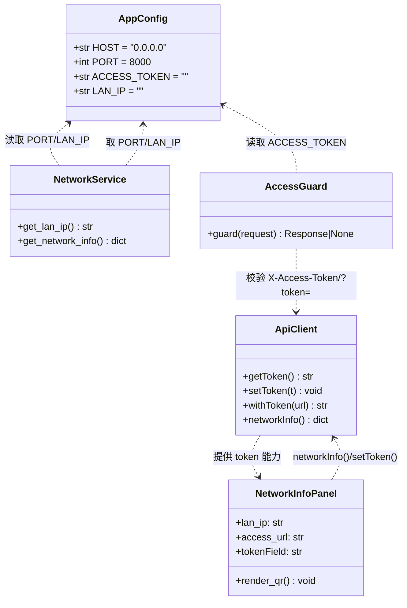
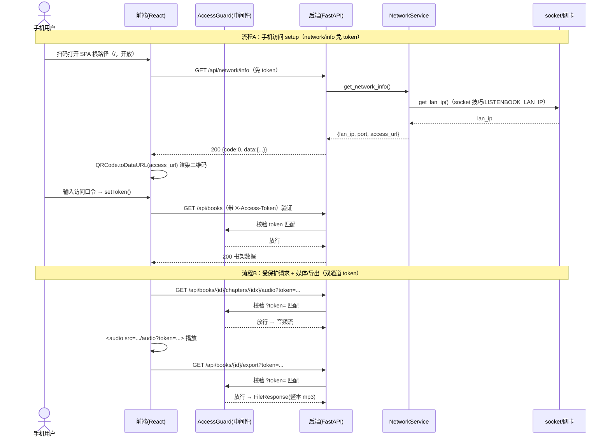
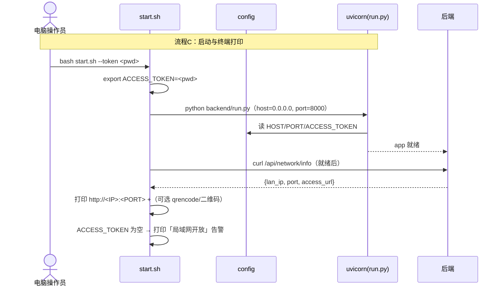

# 听书宝（listen_book）· 增量设计与任务分解（v1.3 局域网/手机访问）

> 版本：v1.3 增量 ｜ 架构师：高见远（Bob）｜ 语言：简体中文
> 形态：本地网页应用（前后端均运行于本机）
> 技术栈：后端 Python 3.11 + FastAPI + edge-tts；前端 Vite + React + MUI + Tailwind CSS
> 关联文档：`ARCHITECTURE.md`（v1.0 基线）、`ARCHITECTURE_INCREMENT.md`（v1.1 分章）、`ARCHITECTURE_INCREMENT2.md`（v1.2 导出/续听/书签）、`PRD_INCREMENT3.md`（本次 PRD）

---

## 0. 与既有架构的关系（红线与不变项）

本次增量**不推翻** v1.0–v1.2，仅在之上叠加「局域网绑定 / 网络访问信息 / 可选访问口令」三块能力。明确继承项：

| 项目 | 基线约定 | 本次是否改变 |
| --- | --- | --- |
| 原始文件红线 | `original_path` 仅记录，后端绝不读/写/删/移动用户 txt/epub/pdf | **不变**（强化：本增量零文件读写） |
| 运行态单命令 | `python backend/run.py` 托管 `frontend/dist` | **不变**（脚本封装它） |
| 统一响应 | `{code,data,message}`，`code==0` 成功 | **不变**（401 亦走信封） |
| CORS | `allow_origins=["*"]` | **不变**（同源场景下不触发跨域） |
| 静态站点根 `/` | 托管 SPA，不拦截 | **不变**（仅 `/api/*` 受 token 保护） |
| 音频/导出路径 | `data/audio/<id>/<idx>.mp3`、`data/export/<id>.mp3` | **不变**（仅新增 token 校验层） |

> **本增量红线强化**：仅调整网络绑定、新增「读取网卡地址 / 校验 token / 渲染二维码」逻辑，**不读写任何用户原始文件，也不写 `data/` 内既有业务数据**（网络信息只读网卡、口令仅做请求校验、二维码仅渲染图像，三者均无持久化副作用）。

---

## 1. 关键决策（先定调，避免歧义）

### 1.1 环境变量命名表（统一口径）

| 变量 | 作用 | 默认值 | 来源 |
| --- | --- | --- | --- |
| `LISTENBOOK_HOST` | 覆盖监听地址 | `"0.0.0.0"`（开箱即监听所有网卡） | `config.HOST` |
| `LISTENBOOK_PORT` | 覆盖监听端口 | `8000` | `config.PORT` |
| `ACCESS_TOKEN` | 访问口令；**空 = 不启用** | `""` | `config.ACCESS_TOKEN` |
| `LISTENBOOK_LAN_IP` | 显式指定局域网地址（多网卡优选/规避 NAT） | `""`（自动探测） | `config.LAN_IP` |

> **命名分歧说明**：`PRD_INCREMENT3.md` 的「附」中曾用 `LISTENBOOK_TOKEN`，而本设计依架构任务指令采用 **`ACCESS_TOKEN`**（无前缀，与 `LISTENBOOK_HOST/PORT` 区分）。以本设计为准；建议 PM 同步 PRD 文案，避免团队混淆。

### 1.2 `/api/network/info` 是否受 token 保护 → **决定：不受保护（白名单）**

- **理由**：该端点仅暴露「局域网 IP + 端口」（与网络扫描可得信息等价，无敏感性）。更重要的是**避免 setup 死锁**——手机用户需先加载 SPA（根路径本就开放），再拿到可访问 URL/二维码才能进入「输入口令」流程；若 network/info 受 token 保护，而未设口令前手机又拿不到 URL，则首访即卡死。故将其与 `/api/health` 一同列入白名单。
- **取舍代价**：同 WiFi 任意设备可探测到你的局域网 IP:端口（本就可通过扫描获得），但**拿不到任何业务数据/音频/导出**（那些仍受 token 保护）。可接受。

### 1.3 token 传递双通道（强制覆盖 media / 下载）

- 所有 `fetch` 类 `/api` 请求：自动附加 **`X-Access-Token` Header**。
- `<audio src>` 与 `<a download href>` 这类浏览器原生请求**无法附加自定义 Header**，故其 URL 必须自动拼接 **`?token=<token>`** 查询参数。
- 后端中间件同时接受「Header `X-Access-Token` **或** 查询 `?token=`」，二者任一匹配即放行。
- **前置条件**：token 仅在 `ACCESS_TOKEN` 非空时启用；为空则全部放行（局域网全开，需 UI/日志告警）。

### 1.4 局域网 IP 探测方案（最小依赖）

- **首选标准库 `socket` 技巧**：建一个 UDP socket 连向公网地址（`connect` 不真正发包），取 `sockname()[0]` 即「走默认路由的那张网卡」的 IPv4——通常是手机可达的 LAN IP；无需任何第三方依赖。
- **覆盖机制**：若设 `LISTENBOOK_LAN_IP`，直接采用该值（多网卡/VPN/容器桥接/NAT 场景下的人工兜底）。
- **显式排除**：不引入 `ifaddr`/`netifaces` 等重依赖；仅当 socket 技巧失败（无默认路由）时回退 `"127.0.0.1"`。
- **多网卡取舍**：socket 技巧天然取「默认路由网卡」的首个非回环 IPv4，比「遍历所有网卡取第一个」更优；复杂网络下由 `LISTENBOOK_LAN_IP` 兜底。

### 1.5 二维码库选型

- **前端**：采用 npm 包 **`qrcode`**（纯 JS、零后端依赖、可 `QRCode.toDataURL(text)` 直接出 `` dataURL）。前端生成 `access_url` 的二维码。
- **终端（P1 便捷项）**：优先 `qrencode -t ANSI` 打印 ASCII 二维码；否则用 venv 内 `python -m qrcode "<url>"`；均无则**降级仅打印 URL**，绝不中断启动。

### 1.6 端点白名单（免 token）

| 路径 | 说明 | 是否受 token |
| --- | --- | --- |
| `/api/health` | 健康检查（start.sh / 探针用） | **免** |
| `/api/network/info` | 返回局域网访问信息 | **免**（见 1.2） |
| 其余所有 `/api/*` | 书籍/音频/导出/书签/设置等 | **启用时受保护** |

---

## 2. 实现方案与框架选型

### 2.1 后端绑定 `0.0.0.0`（config + run.py 现状确认）

- **现状确认**：`run.py` 已 `from backend.config import HOST, PORT` 并以 `uvicorn.run("backend.main:app", host=HOST, port=PORT, reload=False)` 启动——**run.py 本增量无需改动代码**，绑定地址完全由 `config.HOST` 默认值驱动。
- **变更点仅在 `config.py`**：`HOST` 默认值由 `"127.0.0.1"` 改为 `"0.0.0.0"`；新增 `PORT`（env 覆盖）、`ACCESS_TOKEN`、`LAN_IP`。
- **效果**：默认开箱即监听所有网卡，`http://localhost:8000` 与 `http://<LAN_IP>:8000` 同时可用；设 `LISTENBOOK_HOST=127.0.0.1` 可回退到仅本地。

### 2.2 网络信息端点 + IP 探测实现思路

新增独立模块 `backend/netinfo.py`（与队列/TTS 解耦，便于单测），设计签名：

```python
# 设计级伪签名（非实现）
def get_lan_ip() -> str:
    """LISTENBOOK_LAN_IP 优先；否则 socket 技巧取默认路由网卡 IPv4；失败回退 127.0.0.1。"""

def get_network_info() -> dict:
    """返回 {'lan_ip':..., 'port': config.PORT, 'access_url': f'http://{lan_ip}:{port}'}。"""
```

IP 探测核心（设计草图）：

```python
def get_lan_ip():
    env = os.getenv("LISTENBOOK_LAN_IP")          # 显式覆盖
    if env:
        return env
    s = socket.socket(socket.AF_INET, socket.SOCK_DGRAM)
    try:
        s.connect(("8.8.8.8", 80))                 # 不真正发包
        return s.getsockname()[0]                  # 默认路由网卡 IPv4
    except OSError:
        return "127.0.0.1"
    finally:
        s.close()
```

端点（白名单、免 token）返回 `_ok({lan_ip, port, access_url})`，与现有 `_ok` 信封一致。

### 2.3 口令中间件设计

采用 **FastAPI HTTP 中间件**（覆盖所有 `/api/*`，含音频流/导出等由路由处理的请求；静态根 `/` 不拦截）。设计草图：

```python
WHITELIST = {"/api/health", "/api/network/info"}

@app.middleware("http")
async def access_token_guard(request: Request, call_next):
    path = request.url.path
    if not path.startswith("/api"):
        return await call_next(request)            # 静态资源不校验
    if path in WHITELIST:
        return await call_next(request)            # 白名单免校验
    if not config.ACCESS_TOKEN:
        return await call_next(request)            # 未启用口令：全开
    provided = (request.headers.get("X-Access-Token")
                or request.query_params.get("token"))
    if provided != config.ACCESS_TOKEN:
        return JSONResponse(
            status_code=401,
            content={"code": 401, "data": None, "message": "访问口令错误或未提供"},
        )                                          # 与 _http_exception_handler 信封同构
    return await call_next(request)
```

- **与现有信封兼容**：返回 `JSONResponse(401, {code,data,message})`，与 `_http_exception_handler` 输出结构一致，前端统一解析。
- **双通道**：`X-Access-Token` Header（fetch 用）与 `?token=` 查询（audio/download 用）任一匹配即通过。
- **空口令即跳过**：`config.ACCESS_TOKEN == ""` 时完全不校验（局域网全开）。

### 2.4 前端增量（最小改动方案）

| 文件 | 改动 | 说明 |
| --- | --- | --- |
| `src/api/client.js` | 新增 `getToken/setToken/clearToken`（存 localStorage）、`withToken(url)`；`request()` 自动附 `X-Access-Token`；`getAudioUrl/getChapterAudioUrl/exportBookUrl` 经 `withToken` 拼 `?token=`；新增 `networkInfo()` | **唯一核心改动点**，集中处理 token 注入 |
| `src/components/NetworkInfo.jsx` | **新增**：对话框，拉取 `/api/network/info`，用 `qrcode` 渲染 `access_url` 二维码，含口令输入框（保存并验证） | 手机访问入口载体 |
| `src/App.jsx` | AppBar 增加「手机访问」按钮 + 挂载 `<NetworkInfo open onClose>` | 最小：仅加按钮与对话框状态 |
| `src/components/PlayerDrawer.jsx` | **无需改动**——其 `<audio src={api.getChapterAudioUrl(...)}>` 已走 client.js，token 自动注入 | 确认性 |
| `src/components/BookCard.jsx` | **无需改动**——其 `href={api.exportBookUrl(...)}` 已走 client.js，token 自动注入 | 确认性 |

`client.js` token 工具设计草图：

```js
const TOKEN_KEY = "listenbook_token";
export const getToken = () => localStorage.getItem(TOKEN_KEY) || "";
export const setToken = (t) => t ? localStorage.setItem(TOKEN_KEY, t) : localStorage.removeItem(TOKEN_KEY);
export const withToken = (url) => {
  const t = getToken();
  if (!t) return url;
  const sep = url.includes("?") ? "&" : "?";
  return `${url}${sep}token=${encodeURIComponent(t)}`;
};
// request() 内：if (getToken()) headers["X-Access-Token"] = getToken();
// getChapterAudioUrl / exportBookUrl 返回值外面包一层 withToken(...)
```

`NetworkInfo.jsx` 行为：

1. 打开即 `api.networkInfo()`（免 token）→ 取 `{lan_ip, port, access_url}`。
2. `const url = await QRCode.toDataURL(access_url)` → `` 展示二维码。
3. 口令输入：点「保存」→ `setToken(value)` → 调 `api.listBooks()` 验证（带 token 的 `/api/books` 应通过 200，错误口令 401）→ 成功 `notify` 并关闭。
4. 无 token 时显式提示「未设口令 = 局域网开放，仅在信任 WiFi 使用」。

### 2.5 `start.sh` / `start.bat` 变更

| 步骤 | 关键设计 | 说明 |
| --- | --- | --- |
| 参数解析 | `start.sh` 支持 `--token X` → `export ACCESS_TOKEN="X"`；已设 `ACCESS_TOKEN` 环境变量则沿用 | 经 env 注入，run.py/config 无需改参数解析 |
| 启动 | 维持 `nohup python backend/run.py &` | 端口由 config 决定 |
| 启动后打印 | 轮询就绪后 `curl -s localhost:8000/api/network/info` → 解析 `lan_ip`/`port` → 打印 `http://<IP>:<PORT>` | 复用既有的就绪等待逻辑 |
| 终端二维码（P1） | 优先 `qrencode -t ANSI "$URL"`；否则 `python -m qrcode "$URL"`（venv 内）；否则仅打印 URL | 纯 SSH/无图形不中断 |
| 无口令告警 | 若 `ACCESS_TOKEN` 为空，打印「⚠ 未设访问口令，服务对局域网开放」 | 安全提示 |
| `start.bat` | 同步 `--token` 解析（set ACCESS_TOKEN=）、打印 URL；二维码可选（Windows 下 qrencode 不一定存在，降级打印） | 与 sh 对齐 |

### 2.6 依赖变更

- **前端 `package.json`**：`dependencies` 新增 `"qrcode": "^1.5.3"`（纯 JS，无需 `@types`）。其余不变。
- **后端 `requirements.txt`**：**无新增**（IP 探测用标准库；终端二维码复用既有 venv）。保持轻量。

---

## 3. 文件列表（增量）

| 文件 | 动作 | 职责 |
| --- | --- | --- |
| `backend/config.py` | 改 | `HOST` 默认 `"0.0.0.0"`（env 覆盖）；新增 `PORT`/`ACCESS_TOKEN`/`LAN_IP`；保持 `ensure_dirs` 不变 |
| `backend/run.py` | 确认（不改） | 已引用 `HOST/PORT` 启动 uvicorn；绑定 0.0.0.0 由 config 驱动 |
| `backend/netinfo.py` | 新增 | `get_lan_ip()`（socket 技巧 + `LISTENBOOK_LAN_IP` 覆盖）、`get_network_info()` |
| `backend/main.py` | 改 | 新增 `GET /api/network/info`（白名单）、新增 `access_token_guard` 中间件 |
| `frontend/src/api/client.js` | 改 | token 读写/`withToken`/`networkInfo`；请求与媒体/导出链接自动带 token |
| `frontend/src/components/NetworkInfo.jsx` | 新增 | 网络信息对话框 + 二维码 + 口令输入 |
| `frontend/src/App.jsx` | 改 | AppBar「手机访问」按钮 + 挂载 NetworkInfo |
| `frontend/src/components/PlayerDrawer.jsx` | 确认（不改） | `<audio src>` 经 client.js 自动带 token |
| `frontend/src/components/BookCard.jsx` | 确认（不改） | 导出 `<a download>` 经 client.js 自动带 token |
| `frontend/package.json` | 改 | 新增 `qrcode` 依赖 |
| `start.sh` | 改 | `--token` 参数、启动后打印局域网 IP/URL +（可选）终端二维码、无口令告警 |
| `start.bat` | 改 | 同步 `--token` 与 URL 打印 |

---

## 4. 数据结构与接口（增量）

### 4.1 config 常量增量（`backend/config.py`）

| 常量 | 类型 | 默认 | 说明 |
| --- | --- | --- | --- |
| `HOST` | str | `"0.0.0.0"` | 监听地址；`LISTENBOOK_HOST` 可回退 `127.0.0.1` |
| `PORT` | int | `8000` | 监听端口；`LISTENBOOK_PORT` 可覆盖 |
| `ACCESS_TOKEN` | str | `""` | 访问口令；取自 `ACCESS_TOKEN` env；空=不启用 |
| `LAN_IP` | str | `""` | 显式指定局域网地址；`LISTENBOOK_LAN_IP` 覆盖自动探测 |

### 4.2 网络信息端点响应

| 方法 | 路径 | token | 响应 `data` |
| --- | --- | --- | --- |
| GET | `/api/network/info` | 免（白名单） | `{ lan_ip: str, port: int, access_url: str }`（`access_url = "http://<lan_ip>:<port>"`） |

> 其余既有 `/api/*` 端点在启用口令时统一受 `access_token_guard` 保护（白名单除外），**响应结构不变**。

### 4.3 类图（增量）



### 4.4 时序图（增量）





---

## 5. 有序增量任务列表（T1–T8）

> 依赖箭头：Ti → Tj 表示 Tj 依赖 Ti。验收点均可在干净环境复现。T4 可与 T2/T3 并行开发（前端 mock）。

| 编号 | 任务 | 依赖 | 对应文件 | 验收点 |
| --- | --- | --- | --- | --- |
| **T1** | 配置层增量：`HOST` 默认 `"0.0.0.0"`（`LISTENBOOK_HOST` 回退）、`PORT`（默认 8000，`LISTENBOOK_PORT` 覆盖）、`ACCESS_TOKEN`（默认 `""`，取自 `ACCESS_TOKEN` env）、`LAN_IP`（`LISTENBOOK_LAN_IP` 覆盖）；确认 `run.py` 已引用 `HOST/PORT`（无需改） | 无 | `backend/config.py`、`backend/run.py`（确认） | 不传 env 默认 `0.0.0.0:8000`；`LISTENBOOK_HOST=127.0.0.1` 回退本地；`ACCESS_TOKEN` 正确读入；`LISTENBOOK_LAN_IP` 可读 |
| **T2** | 网络信息端点 + IP 探测：新增 `netinfo.py`（`get_lan_ip` socket 技巧 + `LISTENBOOK_LAN_IP` 覆盖；`get_network_info` 返回 `{lan_ip,port,access_url}`）；`main.py` 新增 `GET /api/network/info`（白名单、免 token，走 `_ok` 信封） | T1 | `backend/netinfo.py`、`backend/main.py` | 返回合法 JSON；`lan_ip` 为首个非回环 IPv4；`port` 与绑定一致；`access_url` 拼接正确；`LISTENBOOK_LAN_IP` 生效；socket 失败回退 `127.0.0.1` |
| **T3** | 口令中间件：在 `main.py` 注册 `access_token_guard` HTTP 中间件，对 `/api/*` 排除白名单（`/api/health`、`/api/network/info`）校验 `X-Access-Token` Header **或** `?token=` 查询；缺失/错误 → `401 {code,message}` 信封；`ACCESS_TOKEN` 空则跳过 | T1 | `backend/main.py` | 启用且未带 token → 401；带正确 token → 通过；关闭 → 全开；白名单免校验；`<audio>`/`<a download>` 用 `?token=` 通过 |
| **T4** | 前端 API 客户端 token 封装：`client.js` 增加 `getToken/setToken/clearToken`（localStorage）、`withToken(url)` 拼 `?token=`；`request()` 自动附 `X-Access-Token`；`getAudioUrl/getChapterAudioUrl/exportBookUrl` 经 `withToken`；新增 `networkInfo()` | 无 | `frontend/src/api/client.js` | 各 `/api` 请求自动带 Header；媒体/导出链接自动带 `?token=`；token 空时不附加；`networkInfo()` 返回 `{lan_ip,port,access_url}` |
| **T5** | 前端网络信息面板（二维码 + 口令）：新增 `NetworkInfo.jsx`（拉取 `/api/network/info`、`qrcode` 渲染 `access_url`、口令输入与保存并验证）；`App.jsx` AppBar 加「手机访问」按钮 + 挂载对话框；`package.json` 加 `qrcode` | T2, T4 | `frontend/src/components/NetworkInfo.jsx`、`frontend/src/App.jsx`、`frontend/package.json` | 面板显示 IP/端口/可扫二维码；输入口令保存后后续请求自动携带；无 token 时提示局域网开放风险；`npm install` 含 `qrcode` |
| **T6** | PlayerDrawer / BookCard 带 token（最小确认性改动）：因 `client.js` 的 `getChapterAudioUrl/exportBookUrl` 已含 `withToken`，确认 `<audio src>` 与导出 `<a download>` 自动携带 `?token=`；无额外改动或仅微调 | T4 | `frontend/src/components/PlayerDrawer.jsx`、`frontend/src/components/BookCard.jsx`（确认） | 启用口令后手机端音频流与整本导出可正常加载（不再 401）；旧行为不变 |
| **T7** | `start.sh` / `start.bat` 打印局域网 IP 与 URL（+ 二维码）：`--token` 参数 → 导出 `ACCESS_TOKEN`；启动后 `curl /api/network/info` 取 `lan_ip/port` 打印访问 URL；优先 `qrencode` 或 venv `python -m qrcode` 打印终端二维码，降级仅打印 URL；无 token 打印「局域网开放」告警 | T2 | `start.sh`、`start.bat` | 启动后终端可见 `http://<IP>:<PORT>`；可选 ASCII 二维码；纯 SSH 无图形不中断；未设口令打印告警 |
| **T8** | 联调与回归（绑定/扫码/口令/红线）：绑定 0.0.0.0 后 `localhost` 与局域网 IP 均可访问；手机扫码打开 → 输入口令 → 音频/导出可用；关闭口令全开；回归删除红线不受影响（不读写原始文件） | T3, T5, T6, T7 | `docs/`（回归说明）、`backend/main.py` | 全流程通过；设/不设 token 行为符合预期；删除后 `original_path` 指向文件 size/mtime 不变；旧单章/分章书仍可播放 |

> 注：T1 与 T4 可并行启动；T5 可在 T2/T3 后端就绪前以 mock 并行开发，但联调依赖 T2/T3。T8 为收尾回归，覆盖红线在 LAN 模式下仍成立。

---

## 6. 共享约定 / 风险

### 6.1 共享约定

- **token 统一传递**：fetch 类请求用 Header `X-Access-Token`；`<audio src>`/`<a download>` 用 `?token=`。前端统一在 `client.js` 注入，业务组件无感知。
- **token 存储**：`localStorage` 键 `listenbook_token`；空值 = 未设置。
- **白名单固定**：`/api/health`、`/api/network/info` 始终免 token。
- **绑定默认值**：`HOST="0.0.0.0"`、`PORT=8000`；回退变量 `LISTENBOOK_HOST`/`LISTENBOOK_PORT`。
- **局域网地址**：优先 `LISTENBOOK_LAN_IP` 显式指定，否则 socket 技巧自动探测。
- **二维码内容**：严格为 `http://<lan_ip>:<port>`（SPA 根路径），与 network/info 的 `access_url` 一致。

### 6.2 风险与对策

| 风险 | 对策 |
| --- | --- |
| 多网卡取到 VPN/容器/ NAT 地址（手机不可达） | socket 技巧取默认路由网卡；允许 `LISTENBOOK_LAN_IP` 人工指定；UI/启动日志提示若扫码打不开请检查 IP |
| 关闭口令 = 局域网全开 | `start.sh` 与 NetworkInfo 面板双重告警「仅在信任 WiFi 使用」；建议随手设一个口令 |
| localStorage 明文存 token（同设备 XSS/其他应用可读） | 文档明示为「轻量防护非加密」；后续可改 `sessionStorage`/内存态（P2）；HTTPS 不在本期 |
| `<audio>/<a download>` 无法带 Header 导致 401 | 强制 `?token=` 双通道（已写入设计）；联调重点验证媒体/导出在设口令后可用 |
| 401 与现有信封不一致 | 中间件直接返回 `{code:401,data:null,message:...}`，与 `_http_exception_handler` 同构；前端统一解析 |
| 端口被占用/0.0.0.0 暴露面 | 仅监听地址变更，端口沿用 8000；暴露面风险已在安全章节说明，靠口令+信任网络缓解 |

### 6.3 待明确事项

1. **env 命名分歧**：PRD 曾用 `LISTENBOOK_TOKEN`，本设计采用 `ACCESS_TOKEN`（依架构任务指令）。建议 PM 同步 PRD 文案。
2. **口令强度/防爆破**：本期不做速率限制/账号体系，仅单 token 轻量防护，文档需明示其边界。
3. **HTTPS（P2）**：本期全 HTTP 明文，token 同理明文；`LAN-009` 记录为后续迭代（自签证书/反代）。
4. **终端二维码依赖**：`qrencode`/`python -m qrcode` 均不一定存在，已设计降级为「仅打印 URL」，不影响启动。

---

## 附：类图 / 时序图

（已内联于 §4.3 / §4.4，便于单文件查阅。）
